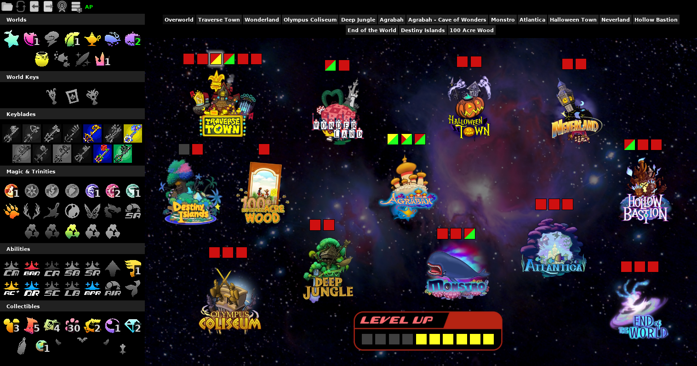
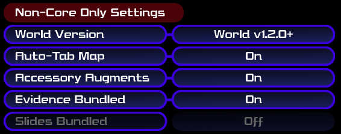

# Kingdom Hearts Final Mix AP Tracker

A [PopTracker](https://github.com/black-sliver/PopTracker/) Pack for Kingdom Hearts Final Mix to be used for the multiworld randomizer [Archipelago](https://archipelago.gg/).

## Getting Started

Download the kh1_ap_tracker.zip file from the latest [Release](https://github.com/culk/Kingdom-Hearts-FM-AP-Tracker/releases) and either drag it to the [PopTracker](https://poptracker.github.io/) window or place it in your `poptracker/packs` directory.

### Detailed Setup Instructions

1. Download and install [PopTracker](https://poptracker.github.io/).
2. Download the PopTracker pack named "kh1_ap_tracker.zip" from the [latest release](https://github.com/culk/Kingdom-Hearts-FM-AP-Tracker/releases/latest) under "Assets".
3. Start PopTracker then drag and drop the "kh1_ap_tracker.zip" file onto the PopTracker window to install the pack. Alternatively, move the "kh1_ap_tracker.zip" file into your `poptracker/packs` directory without unzipping the pack.
4. Connect PopTracker to an Archipelago Multiworld for autotracking by clicking on the grey "AP" icon and then entering your Archipelago host and port information followed by your slot name and password. The "AP" icon will turn green if you are successfully connected.

## Features

- Supports advanced difficulty settings and color codes locations that require higher difficulty logic. Green locations are reachable on the current logic setting. Yellow are reachable out of logic with advanced tricks or difficult combat. Red are not reachable.
- Automatically reads player options from the AP server.
- Autotracking of found key items and checked locations.
- Highlighting of hinted item locations.

## Compatibility

The most recent release of this PopTracker pack is compatible with the following versions of the AP world in addition to the core version that comes with the AP launcher. Locations and logic available only in non-core versions are shown by changing the "World Version" setting to the correct world version.

| Non-Core World Version    | Supported since pack version |
|---------------------------|------------------------------|
| v1.3.0+ (main website)    | v1.5.2+                      |
| v1.2.0 (old)              | v1.5.2+                      |
| v1.1.0 (old)              | v1.3.1+                      |

## Screenshot

## Pack Settings

All settings are loaded automatically when connecting the tracker to the AP server. Settings can also be changed manually to update which locations are displayed as available checks.

Settings are divided into five sections: settings, locations, goal, collectible requirements, and non-core only settings.

### Settings

The Settings section controls when checks are considered available in logic or by a sequence break.

- **Logic Difficulty** controls what kinds of movement or skips are required to reach out of logic check locations. Checks that are only reachable with more advanced tricks than this setting's value are considered "out of logic". Out of logic checks will display as yellow on the map tracker. Logic difficulty options:
    - Beginner: Logic only expects what would be the natural solution in vanilla gameplay or similar, as well as a guarantee of tools for boss fights.
    - Normal: Logic expects some clever use of abilities, exploration of options, and competent combat ability; generally does not require advanced knowledge.
    - Proud: Logic expects advanced knowledge of tricks and obscure interactions, such as using Combo Master, Dumbo, and other unusual methods to reach locations.
    - Minimal: Logic expects the bare minimum to get to locations; may require extensive grinding, beating fights with no tools, and performing very difficult or tedious tricks.
- **Keyblade Locks** controls whether world-specific keyblades are needed to open chests in their respective world.
- **Stacking World Items** and **Halloween Town Key Item Bundled** control how worlds and key items unlock locations.
- **Accessory** controls whether new party members have checks for randomized starting accessories.

### Locations

The Locations section controls which optional world and minigame locations are enabled. Disabled options are not displayed on the map tracker.

### Goal

The Goal section controls the requirements for unlocking the **End of the World** and opening the **Final Rest Door**.

### Collectible Requirements

The Collectible Requirements section controls how many of a collectible are required for their respective goal. Note that a collectable is only required if their respective goal is set or if Destiny Islands checks are enabled.

### Non-Core Only Settings

These settings require the non-core (beta) version of the AP world. These settings are not available in the core version packaged with the AP launcher.

- **World Version** - Changes the items, locations, and access logic to match the non-AP core versions of the AP world. This value is automatically detected when connecting to the AP server and should only be manually changed if you are playing a non-core version offline with manual tracking.
- **Auto-Tab Map** - Requires AP world version v1.1.0 or newer and an active connection to the AP server using the in-game client. Enables or disables the map tab auto updating to the players current world.
- **Accessory Augments** - Requires AP world version v1.1.0 or newer. Enables tracking of accessory augment items and advanced logic that requires accessory augments.
- **Evidence Bundled** - Requires AP world version v1.2.0 or newer. Tracks Wonderland's evidence key items as a single bundled item.
- **Slides Bundled** - Requires AP world version v1.2.0 or newer. Tracks Deep Jungle's slides key items as a single bundled item.

## Feedback

Feedback is always appreciated. If there is an issue with the tracker, either open an issue here on github or contact me via Discord.

## Credits

- Original [Kingdom Hearts Final Mix AP Tracker](https://github.com/Lojtana/Kingdom-Hearts-FM-AP-Tracker) created by Lojtana.
- Keyblade icons are adapted from [Kingdom Hearts: Chain of Memories cards](https://www.spriters-resource.com/game_boy_advance/khcom/asset/1054/) by [GaryCXJk](https://www.spriters-resource.com/submitter/GaryCXJk/).
- All fonts and all other icons were made by [Televo](https://github.com/Televo/kingdom-hearts-recollection).
- Overview map background image is adapted from "[M42 Orion & Running Man](https://www.flickr.com/photos/65141172@N00/23216543151/)" by [Dylan O’Donnell](https://deography.com/), used under [CCO 1.0](https://creativecommons.org/publicdomain/zero/1.0/).
- All other map images made by [culk](https://github.com/culk) using Kingdom Hearts map models hosted on [noclip](https://noclip.website/) by [magcius](https://github.com/magcius). These map images are licensed under [CC BY 4.0](https://creativecommons.org/licenses/by/4.0/)